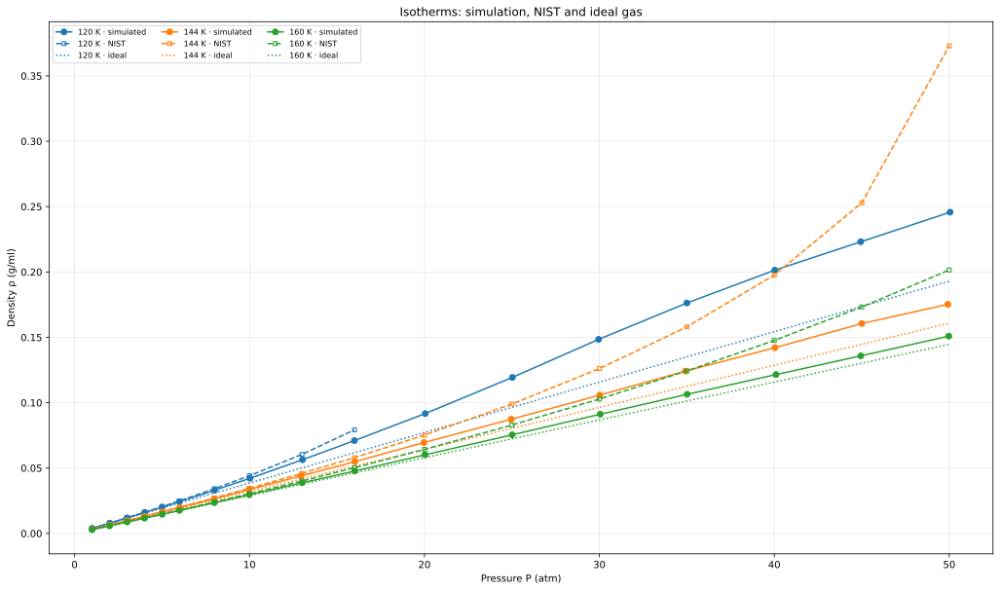

# Лабораторная работа №1. Изотермическое сжатие газа

**Автор:** Донецков Андрей Дмитриевич, Б23-215. **Дата:** 16.10.2026.

**Цель:** проверить применимость модели Леннарда–Джонса для фтора F₂ ниже, вблизи и выше критической температуры ([NIST](https://webbook.nist.gov/cgi/cbook.cgi?ID=C7782414&Mask=4): ≈144 К).

## Модель и параметры

Одна частица представляет молекулу F₂; молярная масса — 37,9968 г/моль.

$$
U(r)=4\varepsilon\left[(\sigma/r)^{12}-(\sigma/r)^6\right],\qquad
\varepsilon=0{,}149507\ \text{ккал/моль},\quad \sigma=4{,}490977\ \text{Å}.
$$

Параметры подобраны [скриптом](find_params.py) по второму вириальному коэффициенту семи [изотерм NIST](data/fluorine/), 80–200 К. Для каждой использованы восемь наименее плотных газовых точек: $Z-1=B_2c+B_3c^2$, где $Z=P/(cRT)$, $c$ — молярная плотность.

## Размер системы

При 144 К, 2 атм проверены $N=4,32,108,256,500,864,1372,2048$. Критерии: относительная полуширина 95%-интервала плотности, дрейф между половинами выборки и расхождение с $N=2048$ с учётом неопределённости — не более 1%; время интегрирования — не более 2 с.

| N | 95%-полуширина, % | Дрейф, % | Расхождение с учётом неопределённости, % | Время, с |
|---:|---:|---:|---:|---:|
| 500 | 0,92 | 0,00 | 1,19 | 1,15 |
| **864** | **0,51** | **0,52** | **0,64** | **1,93** |
| 1372 | 0,37 | 0,28 | 0,61 | 2,99 |
| 2048 | 0,31 | 0,18 | — | 4,48 |

Выбрано **864 частицы**: минимальный размер, удовлетворяющий критериям; все большие размеры проходят проверку точности. Интервалы приближённые, предполагают независимость блоков. [Расчёт](find_optim_size.py), [полная таблица](data/tmp/size_study.csv).

## Условия моделирования

Во всех точках использованы LAMMPS, ансамбль NPT, периодические границы, $N=864$, шаг 1 фс; термостат и баростат Нозе–Гувера с временами релаксации 100 и 1000 фс. Радиус отсечения — 11,2274 Å (≈2,5σ), без хвостовой поправки. Начальные координаты — ГЦК, объём — по идеальному газу, скорости — гауссовы, seed=35709.

Уравновешивание — 20 пс, сбор данных — 100 пс: 10 блоков по 10 пс, выборка каждые 100 фс. В каждой точке задавались $T,P$ и усреднялась плотность.

## Изотермы и сравнение

Температуры: **120, 144, 160 К**; по **17 точек** при $P=1,2,3,4,5,6,8,10,13,16,20,25,30,35,40,45,50$ атм.

Идеальный газ: $\rho=PM/(RT)$. Ошибка при одинаковых заданных $T,P$: $\delta=100|\rho/\rho_{\mathrm{NIST}}-1|$.

| T, К | Последняя общая точка P, атм | δ МД, % | δ идеального газа, % |
|---:|---:|---:|---:|
| 120 | 16 | 10,4 | 22,1 |
| 144 | 50 | 53,0 | 56,9 |
| 160 | 50 | 25,1 | 28,2 |

При 120 К сравнение ограничено газовой ветвью NIST (10 точек); жидкая фаза исключена обработкой.

## Вывод

В рассчитанных точках до 10 атм ошибка МД ≤4,4%; модель точнее идеального газа. При сжатии плотность занижается, особенно вблизи критической температуры: количественное согласие теряется. Подбор по разреженному газу не гарантирует точности плотной фазы. Влияние отсечения, размера системы и длительности уравновешивания при высоких давлениях отдельно не проверялось; фазовый переход не подтверждён.

## Файлы

[Вход LAMMPS](box.lmp), [запуск](run_box.py), [выходы всех точек](data/runs/) (`T…_P…_N864_seed35709.{log,blocks.dat,data}`), [обработка и графики](main.py).
